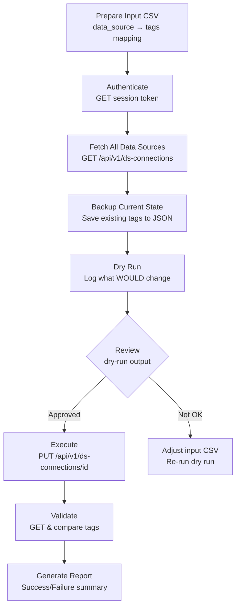

# BigID – Bulk Add Tags to Data Sources (API Automation Guide)
---

## Table of Contents
1. [Problem Statement](#1-problem-statement)
2. [Background – Tags vs Labels in BigID](#2-background--tags-vs-labels-in-bigid)
3. [Approach Options](#3-approach-options)
4. [Recommended Approach – API Automation](#4-recommended-approach--api-automation)
5. [Pre-Requisites & Discovery Phase](#5-pre-requisites--discovery-phase)
6. [Step-by-Step Execution Plan](#6-step-by-step-execution-plan)
7. [API Reference](#7-api-reference)
8. [Automation Script (Python)](#8-automation-script-python)
9. [Input CSV Format](#9-input-csv-format)
10. [Rollback Strategy](#10-rollback-strategy)
11. [Validation & Testing](#11-validation--testing)
12. [Risk & Mitigation](#12-risk--mitigation)
13. [Expected Outcomes / Deliverables](#13-expected-outcomes--deliverables)
14. [Open Questions](#14-open-questions)
15. [References & Research](#15-references--research)

---

## 1. Problem Statement

When there are **many data sources** (e.g., 150+) already configured in BigID, each with existing tags, and new tags need to be **added** based on business requirements (e.g., privacy classification, data domain, regulatory scope, ownership) — a manual approach doesn't scale.

**Challenges:**
- Manually tagging 150+ sources via the BigID UI is **time-consuming and error-prone**.
- Tags must be applied **consistently** across all matching data sources.
- Existing tags must **NOT be overwritten** — new tags should be **appended**.

---

## 2. Background – Tags vs Labels in BigID

| Concept | Purpose | Examples |
|---------|---------|---------|
| **Tags** | Associate **business terms** or functional attributes with data sources. Enhance searchability & organise data. | `Customer-PII`, `Finance-Data`, `EU-Regulated` |
| **Labels** | Signify **sensitivity / risk level** of content. Used with DLP, encryption policies. | `Restricted`, `Confidential`, `Public`, `AI-Prohibited` |

**This guide focuses on Tags (not sensitivity labels).**

### Common tag categories to consider:

| Category | Example Tags | Purpose |
|----------|-------------|---------|
| **Data Domain** | `HR`, `Finance`, `Marketing`, `Engineering` | Business unit ownership |
| **Regulatory** | `GDPR`, `CCPA`, `HIPAA`, `PCI-DSS` | Compliance mapping |
| **Data Residency** | `EU`, `US`, `APAC`, `India` | Geo-location of data |
| **Environment** | `Production`, `Staging`, `Development` | Env classification |
| **Privacy** | `Contains-PII`, `Contains-SPI`, `No-PII` | Privacy posture |
| **AI Eligibility** | `AI-Safe`, `AI-Restricted`, `AI-Prohibited` | GenAI governance |
| **Ownership** | `team-platform`, `team-data-eng` | Team accountability |

---

## 3. Approach Options

### Option A – Manual UI Tagging ❌
- Open each data source in BigID UI → edit → add tags → save.
- **Pros:** No scripting needed.
- **Cons:** Extremely slow for 150+ sources. High risk of human error. Not repeatable.

### Option B – BigID REST API Automation ✅ (Recommended)
- Use the BigID REST API to programmatically fetch, update, and validate tags.
- **Pros:** Fast, repeatable, auditable. Handles 150+ sources in minutes. Supports dry-run & rollback.
- **Cons:** Requires API access and a valid token. Need to understand API payload structure.

### Option C – BigID Bulk Actions (UI) ⚠️
- Some BigID versions support multi-select & bulk actions in the UI.
- **Pros:** No code needed.
- **Cons:** May not support tag addition. Limited filtering. Not available in all versions. Not repeatable.

---

## 4. Recommended Approach – API Automation



---

## 5. Pre-Requisites & Discovery Phase

### 5.1 Access & Permissions
- [ ] Obtain **API access** to BigID instance (base URL).
- [ ] Get or create a **service account** with permission to **read & update** data source configurations.
- [ ] Obtain **session token** via `/api/v1/sessions` endpoint.
- [ ] Confirm the BigID **version** (API endpoints may vary).

### 5.2 Understand Current State
- [ ] Export the **full list** of current data sources and their existing tags.
- [ ] Identify the **exact field name** for tags in the API response (e.g., `tags`, `metadata.tags`, `customTags`).
- [ ] Check if tags are **free-form strings** or must come from a **predefined tag list** (some BigID configs enforce this).
- [ ] Understand if `PUT` does a **full replacement** (most likely) or a **partial merge** — this determines whether we must send the complete object.

### 5.3 Define New Tags
- [ ] Get the **list of new tags** to be added from relevant stakeholders.
- [ ] Create the **mapping**: which data sources get which new tags.
- [ ] Decide the **tag naming convention** (kebab-case, PascalCase, etc.).

---

## 6. Step-by-Step Execution Plan

### Phase 1: Research & Setup (Day 1)
1. Get API credentials and verify connectivity.
2. Call `GET /api/v1/ds-connections` — inspect the response structure.
3. Identify the exact JSON path for the `tags` field.
4. Try a **manual test update** on a single non-production data source.
5. Document the exact API contract (request/response).

### Phase 2: Prepare (Day 1–2)
6. Export all current data sources + tags → `backup_before.json`.
7. Create the input CSV with `data_source_name` → `new_tags` mapping.
8. Write/adapt the automation script.
9. Run **dry-run mode** — review output.

### Phase 3: Execute (Day 2–3)
10. Execute the script in **live mode** (start with a batch of 10 to validate).
11. Verify the first batch in BigID UI.
12. Run the remaining data sources.
13. Export post-update state → `backup_after.json`.
14. Generate diff report.

### Phase 4: Validate & Close (Day 3)
15. Spot-check 10–15 data sources in BigID UI.
16. Run validation script to compare expected vs actual.
17. Document findings, issues, and the final approach.
18. Document final outcomes.

---

## 7. API Reference

### 7.1 Authentication
```bash
# Get session token
curl -X POST "https://<bigid-host>/api/v1/sessions" \
  -H "Content-Type: application/json" \
  -d '{
    "username": "<service-account>",
    "password": "<password>"
  }'

# Response contains: { "auth_token": "eyJhbG..." }
```

### 7.2 List All Data Sources
```bash
curl -X GET "https://<bigid-host>/api/v1/ds-connections" \
  -H "Authorization: <auth_token>"
```

### 7.3 Get a Specific Data Source
```bash
curl -X GET "https://<bigid-host>/api/v1/ds-connections/<connection-name>" \
  -H "Authorization: <auth_token>"
```

### 7.4 Update a Data Source (Add Tags)
```bash
# IMPORTANT: PUT typically does a full replacement.
# Always GET first, merge tags, then PUT the full object back.

curl -X PUT "https://<bigid-host>/api/v1/ds-connections/<connection-name>" \
  -H "Authorization: <auth_token>" \
  -H "Content-Type: application/json" \
  -d '{
    ... full data source object ...,
    "tags": ["existing-tag-1", "existing-tag-2", "NEW-TAG-A", "NEW-TAG-B"]
  }'
```

> ⚠️ **Critical:** The `PUT` endpoint in BigID often performs a **full replacement**. If you only send `{ "tags": [...] }`, you may wipe out other data source fields. Always send the **complete object** back.

---

## 8. Automation Script (Python)

See the full script: `bulk_tag_update.py` (included in this repo).

**Script capabilities:**
- Reads a CSV file mapping data sources to new tags
- Authenticates with BigID API
- Backs up existing state before any changes
- Supports **dry-run mode** (no changes made, only logs)
- Appends tags (does NOT overwrite existing tags)
- Generates a detailed execution report
- Handles errors gracefully with per-source error reporting

### Quick usage:
```bash
# Install dependency
pip install requests

# Dry run (safe — no changes made)
python bulk_tag_update.py --config config.json --input tags_mapping.csv --dry-run

# Live execution
python bulk_tag_update.py --config config.json --input tags_mapping.csv
```

---

## 9. Input CSV Format

Create a CSV file (`tags_mapping.csv`) with the following structure:

```csv
data_source_name,new_tags
my-postgres-prod,"GDPR,Contains-PII,EU"
salesforce-crm,"CCPA,Contains-PII,US"
s3-analytics-bucket,"Finance,No-PII,US"
snowflake-warehouse,"GDPR,CCPA,Contains-SPI,Production"
azure-blob-hr,"HR,Contains-PII,HIPAA,EU"
```

**Rules:**
- `data_source_name` must **exactly match** the name in BigID (case-sensitive).
- `new_tags` is a comma-separated list of tags to **add** (existing tags are preserved).
- Duplicates are automatically skipped (if a tag already exists on the source).

---

## 10. Rollback Strategy


The script automatically creates a backup file (`backup_YYYYMMDD_HHMMSS.json`) before making any changes. To rollback:

```bash
python bulk_tag_update.py --config config.json --rollback backup_20261011_180000.json
```

---

## 11. Validation & Testing

### Pre-execution checks:
- [ ] Dry-run output reviewed and approved.
- [ ] Backup file generated and verified.
- [ ] Test on 1–2 non-critical data sources first.

### Post-execution checks:
- [ ] Run validation script — compare expected tags vs actual tags.
- [ ] Spot-check 10+ data sources in BigID UI.
- [ ] Verify no data source configurations were accidentally modified (compare full object before/after).
- [ ] Check BigID audit logs for the update operations.

### Validation script:
```bash
python bulk_tag_update.py --config config.json --validate tags_mapping.csv
```

---

## 12. Risk & Mitigation

| Risk | Impact | Mitigation |
|------|--------|------------|
| `PUT` overwrites entire data source config | **Critical** — can break data source connectivity | Always `GET` first, merge tags, then `PUT` complete object |
| Tag name typo | **Medium** — inconsistent tags | Validate tag names against an approved list before execution |
| API rate limiting | **Low** — script may fail mid-way | Add retry logic with exponential backoff + delay between calls |
| Token expiration mid-run | **Medium** — script stops | Implement token refresh logic; re-auth on 401 |
| Wrong data source targeted | **High** — wrong source tagged | Dry-run first; use exact name matching; backup everything |
| Tag field name different per version | **Medium** — script doesn't work | Discovery phase: inspect API response to confirm field name |
| Predefined tag list enforcement | **Medium** — API rejects unknown tags | Check if BigID instance requires tags from a master list; create tags first if needed |

---

## 13. Expected Outcomes / Deliverables

By the end of this exercise, you should have:

- [x] **Understanding** of BigID's tag API (endpoint, payload, behavior).
- [ ] **Working automation script** tested against the BigID instance.
- [ ] **Input CSV template** ready for stakeholders to fill in.
- [ ] **Backup & rollback strategy** validated.
- [ ] **Execution runbook** for current and future tag updates.
- [ ] **Documentation** of any BigID-specific gotchas or version-specific behavior.

---

## 14. Open Questions

> These should be resolved before execution:

1. **What is the exact API endpoint and field name for tags in the BigID version being used?**
   - Inspect `GET /api/v1/ds-connections` response.

2. **Does the BigID instance enforce a predefined tag list?**
   - If yes, register new tags in BigID admin first.

3. **Is it `PUT` (full replacement) or does BigID support `PATCH` (partial update)?**
   - This determines our update strategy.

4. **What authentication method does the instance use?**
   - Session token via `/sessions`? API key? SSO/SAML?

5. **Are there any existing automation scripts that can be reused?**

6. **What are the exact new tags to be added? Is there a tag taxonomy defined?**
   - Need input from relevant stakeholders.

7. **Should tags be applied uniformly or based on data source attributes (type, region, data domain)?**

8. **Is there a non-prod BigID environment available for testing?**

9. **Are there any change management / approval processes before modifying 150+ data sources?**

10. **Do we need to notify any downstream consumers that tags have changed?**
    - Tags may be used in policies, scans, reports, or integrations.

---

## Quick Reference Commands

```bash
# 1. Check connectivity
curl -s "https://<bigid-host>/api/v1/sessions" -X POST \
  -H "Content-Type: application/json" \
  -d '{"username":"<user>","password":"<pass>"}' | jq .

# 2. List all data sources (pipe to file for review)
curl -s "https://<bigid-host>/api/v1/ds-connections" \
  -H "Authorization: <token>" | jq . > all_datasources.json

# 3. Count data sources
cat all_datasources.json | jq 'length'

# 4. Extract current tags for all sources
cat all_datasources.json | jq '[.[] | {name: .name, tags: .tags}]' > current_tags.json

# 5. Find sources with no tags
cat all_datasources.json | jq '[.[] | select(.tags == null or .tags == []) | .name]'
```

---

## 15. References & Research

> All links below are **official BigID sources** or publicly available documentation. No internal/proprietary information is referenced.

### 15.1 Official BigID Documentation

| Resource | URL | What it covers |
|----------|-----|----------------|
| **BigID Developer Portal** (Home) | https://developer.bigid.com/ | Central hub for all API docs, tutorials, and guides |
| **BigID API Overview** | https://developer.bigid.com/api/bigid-api/ | REST API overview, authentication, getting started |
| **Get Started Guide** | https://developer.bigid.com/guides/get-started/ | Initial setup and first API call |
| **Add Data Source Tutorial** | https://developer.bigid.com/api/bigid-api/add-data-source/ | How to list connectors, test, and add data sources via API |
| **Manage Data Sources Tutorial** | https://developer.bigid.com/api/bigid-api/manage-data-sources/ | Export/import data source definitions via API |
| **Privacy Portal API** | https://developer.bigid.com/privacy-portal-api/authentication/ | Privacy-specific API (DSARs, identity verification) |
| **Apps Framework** | https://developer.bigid.com/apps/building-a-bigid-app/ | Build custom apps on top of BigID platform |
| **Connectors** | https://developer.bigid.com/connectors/what-is-a-bigid-connector/ | Build custom connectors for unsupported data sources |
| **BigID MCP Server (GitHub)** | https://github.com/bigexchange/bigid-plugin-official | Official MCP plugin for Claude, Cursor, VS Code |

### 15.2 Key API Endpoints Used

| Method | Endpoint | Purpose | Reference |
|--------|----------|---------|----------|
| `POST` | `/api/v1/sessions` | Authenticate and obtain session token | [Developer Portal – Authentication](https://developer.bigid.com/api/bigid-api/) |
| `GET` | `/api/v1/ds-connections` | List all data source connections | [Developer Portal – Manage Data Sources](https://developer.bigid.com/api/bigid-api/manage-data-sources/) |
| `GET` | `/api/v1/ds-connections/{name}` | Get a specific data source by name | [Developer Portal – Manage Data Sources](https://developer.bigid.com/api/bigid-api/manage-data-sources/) |
| `PUT` | `/api/v1/ds-connections/{name}` | Update a data source (full replacement) | [Developer Portal – Manage Data Sources](https://developer.bigid.com/api/bigid-api/manage-data-sources/) |
| `POST` | `/api/v1/ds_connections` | Create a new data source | [Developer Portal – Add Data Source](https://developer.bigid.com/api/bigid-api/add-data-source/) |
| `GET` | `/api/v1/ds-connections/file-download/export` | Export all data sources as file | [Developer Portal – Manage Data Sources](https://developer.bigid.com/api/bigid-api/manage-data-sources/) |
| `POST` | `/api/v1/ds-connection-test` | Test a data source connection | [Developer Portal – Add Data Source](https://developer.bigid.com/api/bigid-api/add-data-source/) |
| `POST` | `/api/v1/refresh-access-token` | Exchange long-lived token for session token | [Developer Portal – Authentication](https://developer.bigid.com/api/bigid-api/) |

### 15.3 BigID Feature Flags for Tags

These feature flags may need to be enabled in BigID admin settings before tag APIs work:

| Feature Flag | Purpose |
|--------------|---------|
| `SHOW_DS_TAGS` | Enables data source tags for organising and filtering data sources |
| `TAGS_MANAGEMENT_ENABLED` | Enables the management page/API for creating custom tags |
| `TAGS_ASSIGNMENT_ENABLED` | Enables manual tag assignment on objects and columns |
| `BIGID_LABELS_ENABLED` | Activates BigID's native label management system |
| `OBJECT_COLUMN_DETAILS_CATALOG_FF` | Enables the Tags API for objects and columns in the Data Catalog |

> ⚠️ Verify these flags in your BigID admin console under **Administration > Settings** before running the automation.

### 15.4 Authentication Best Practices (from BigID docs)

- Use **service accounts** with least-privilege roles, not personal admin credentials.
- Generate **long-lived API tokens** via BigID UI under **Administration > Access Management**.
- Exchange long-lived user tokens for **short-lived session tokens** using `/api/v1/refresh-access-token`.
- Include token in header: `Authorization: Bearer <token>` (some versions may omit `Bearer`).
- Tokens can be configured for validity up to **999 days** — keep it short for security.
- Re-authenticate on `401 Unauthorized` responses (token expired).
- Never hardcode tokens in source code — use environment variables or vaults.

### 15.5 Key Design Decisions & Rationale

| Decision | Rationale | Source |
|----------|-----------|--------|
| Use `GET` before `PUT` (full object) | BigID `PUT` does a **full replacement** — sending only `{"tags": [...]}` can wipe other fields | [BigID API Best Practices](https://developer.bigid.com/api/bigid-api/) |
| Per-source API calls (not bulk) | BigID does not natively support bulk import via file upload; data sources must be updated individually | [Developer Portal – Manage Data Sources](https://developer.bigid.com/api/bigid-api/manage-data-sources/) |
| Add rate-limiting delay | Prevent API throttling when updating 150+ sources sequentially | General REST API best practice |
| Backup before update | Immutable snapshot for rollback if tags or configs are accidentally corrupted | Data safety best practice |
| Dry-run mode first | Validate changes without risk — critical for production environments | General automation best practice |
| CSV-based input | Easy for non-technical stakeholders to fill in; version-controllable | Operational best practice |

### 15.6 Additional Reading

- **BigID Product Page:** https://bigid.com/
- **BigID API Tracker (OpenAPI spec):** https://www.apitracker.io/a/bigid
- **BigID on GitHub:** https://github.com/bigexchange
- **BigID Certifications:** https://bigid.com/certifications-and-assessments/
- **BigID Privacy Notice:** https://bigid.com/privacy-notice/
